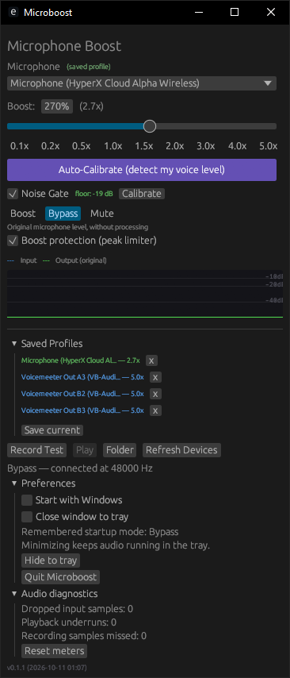

# Microboost

**Fork notice:** this is a personal fork of [alexeygrigorev/microboost](https://github.com/alexeygrigorev/microboost) by [Alexey Grigorev](https://github.com/alexeygrigorev), who wrote the original app. All credit for the audio pipeline, UI, and VB-CABLE integration goes to him. This fork adds:

## Fork changes and bug fixes

The original Git history and attribution are retained. The changes below build on upstream commit `d15a99c`.

### Fixed

- **Stray graphical lines when boost is off:** waveform drawing is clipped to its own rectangle. Overlapping bypass traces no longer create degenerate filled polygons; non-finite meter values are handled safely.
- **Waveform speed depended on mouse movement:** history advances by elapsed time rather than redraw count. Extra input-driven redraws cannot speed up scrolling or postpone its scheduled update. The graph updates about 30 times per second and displays roughly five seconds of history.
- **Noise Gate appeared unclickable:** an uncalibrated gate previously switched its checkbox straight back off. Clicking it now starts the required three-second silent calibration; a calibrated gate can be toggled normally.
- **Boost protection was not a control:** the limiter status text is now accompanied by a real, saved on/off checkbox. Protection defaults to on; disabling it warns that loud audio may distort.
- **Unsafe audio-buffer sharing and unread-data overwrite:** replaced the handwritten shared ring with a bounded Crossbeam queue. Full queues reject samples rather than corrupt unread audio, with diagnostic counters for drops and underruns.
- **Inconsistent sample-rate conversion:** the app and pipeline tests share a resampler that preserves fractional position and samples across input chunks, including mismatched microphone/cable rates.
- **False running state on stream startup failure:** the pipeline is marked running only after both audio streams start successfully; errors are displayed and the connection can be retried.
- **Hot-plug replacement at the same dropdown index:** reconnection compares microphone identity, not just its position in the device list. Recovery reloads the selected microphone's profile.
- **Incorrect recording duration/pitch and duplicate capture:** recordings tap the processed pipeline at its actual microphone sample rate instead of opening another capture stream. Playback resamples using the recording's stored rate.
- **Empty recording left stale state:** stopping without captured audio clears recording state and displays an explanatory message. Session IDs prevent queued samples from an earlier recording leaking into a later one.
- **Unicode microphone names could panic:** saved-profile labels truncate by characters rather than byte offsets.

### Audio and desktop improvements

- The noise gate measures the original signal before amplification, using an RMS envelope, hysteresis, hold, and sample-rate-aware attack/release. Raising boost no longer makes background noise cross the gate threshold.
- Smooth gain changes and an immediate-attack, gradual-release peak limiter reduce clicks and boosted clipping. The UI shows gain reduction and warns separately about clipping already present at the microphone input.
- Separate **Boost**, **Bypass**, and **Mute** modes replace ambiguous start/stop behavior. The last selected mode is remembered, including Mute during reconnection.
- Stream failures are surfaced in the UI. Automatic retries handle unavailable devices and detected pauses/resume; recovery never falls back to routing microphone audio through speakers.
- Main audio callbacks use atomic controls, callback-owned processing state, fixed conversion storage, and preallocated queues. Recording buffers are reserved outside callbacks; recordings stop after 60 seconds.
- Shared adapters support CPAL's signed/unsigned integer and floating-point sample formats instead of assuming every device supplies `f32` audio.
- A resizable, scrolling window and a tray menu provide Show, Boost, Bypass, Mute, and Quit actions. Minimizing keeps audio running in the tray. Close-to-tray and Windows startup are opt-in; startup uses a quoted executable path and opens in the tray.
- The Makefile uses the configured `cargo` command instead of a machine-specific Cargo location.

### Verification and limitations

The hardware-independent suite currently has **26 passing tests**, covering queue bounds/concurrency, chunked resampling, gate/boost independence, limiter toggling, audio modes, sample conversion, playback rate, recording state/session limits, stream-error state, old settings, Unicode labels, graph clipping, and mouse-independent timing. All targets pass `cargo check`; the latest local release was built for `x86_64-pc-windows-gnu`.

These checks do **not** replace a live microphone/VB-CABLE test. Tray interactions, Windows startup, sleep/resume recovery, device-specific sample formats, and audible quality still require manual verification on Windows. The limiter cannot repair a signal already clipped at the microphone. Disabling protection permits hard clipping at full scale. Existing hardware-loopback tools are separate from the hardware-independent suite.

Personal settings, recordings created while using the app, local toolchains, and compiled executables are not part of this fork's source changes. The existing upstream audio fixtures remain in the history.

A Windows microphone booster that amplifies your mic for other apps (Discord, Teams, etc.) using a real-time audio pipeline through [VB-CABLE](https://vb-audio.com/Cable/) — a free virtual audio cable driver that creates a pair of connected audio devices (one for input, one for output) so audio can be routed between applications.



[Watch the demo on Loom](https://www.loom.com/share/8ebfbaf4b31f49fba5b1fdbee01ebd5f)

## How it works

```
Microphone → raw-signal noise gate → smooth gain → peak limiter → queue → resampling → VB-CABLE
                                                                                       ↓
                                                                    Discord/Teams/Zoom picks up
                                                                    "CABLE Output" as microphone
```

1. The audio driver delivers mic samples via an input callback
2. In Boost mode, an RMS-envelope noise gate evaluates the original signal, with hysteresis, hold, and smooth attack/release. Increasing boost no longer opens the gate for background noise
3. Smoothed gain amplifies the signal; a peak limiter holds output below 0.95 full scale. Bypass skips processing; Mute outputs silence
4. Processed samples enter a preallocated, bounded Crossbeam queue. Audio callbacks use atomics instead of shared mutexes and report overflow/underrun counters
5. A separate output callback reads from the queue, converts the microphone sample rate to the output device's rate, and writes to VB-CABLE's virtual input
6. Apps like Discord see "CABLE Output" as a microphone and receive the boosted audio

On first launch, the app will offer to download and install VB-CABLE (free) automatically.

## Features

- Real-time microphone boost from 0.1x to 10x (presets up to 5x)
- Separate Boost, Bypass, and Mute modes, remembered across launches
- Auto-calibration: detects your voice level and targets approximately -16 dBFS RMS
- Noise gate: learns background noise and uses a boost-independent RMS envelope
- Peak limiter with gain-reduction meter and source-clipping warning
- Live waveform visualizer: see input vs boosted output in real-time
- Per-microphone profiles: saves boost and noise gate settings per device
- Mic hot-plug detection, visible stream errors, and automatic reconnection after disconnects or resume
- Automatic VB-CABLE setup on first run
- Test recording (up to 60 seconds) and sample-rate-correct playback
- Lock-free bounded audio buffering, sample-rate conversion, and integer/float audio format support
- Resizable native UI, tray controls, and opt-in Windows startup

## Installation

Download this fork's builds from [Releases](https://github.com/fredrikwallander-cell/microboost/releases). Choose `windows-amd64` for typical Intel/AMD Windows PCs, or `windows-arm64` for Windows on ARM. SHA256 checksum files accompany release binaries. Executables are unsigned; Windows may show a reputation warning. The [upstream releases](https://github.com/alexeygrigorev/microboost/releases) do not include this fork's fixes.

Or build from source:

```bash
git clone https://github.com/fredrikwallander-cell/microboost.git
cd microboost
make build
```

The executable will be at `target/x86_64-pc-windows-msvc/release/microboost.exe`.

> **Note:** The Makefile defaults to the MSVC target (`x86_64-pc-windows-msvc`), which needs Rust and the Visual Studio C++ build tools. You can instead use `make build TARGET=x86_64-pc-windows-gnu` with a compatible GNU linker/toolchain installed. `CARGO` can be overridden if Cargo is not on your PATH.

## Usage

1. Launch Microboost. If VB-CABLE is not installed, click "Install VB-CABLE" and accept the admin prompt.
2. Select your microphone from the dropdown.
3. Click "Auto-Calibrate" to detect your voice level, or manually set the boost.
4. Select **Boost**, **Bypass** (original microphone), or **Mute** (silence). "Accept" after calibration selects Boost.
5. In your other app (Discord, Teams, etc.), select "CABLE Output" as the microphone input.

Use "Record Test" and "Play" to verify the boost sounds right before going live.

Recordings are saved to `%APPDATA%\Microboost\`.

Open **Preferences** to enable **Start with Windows** or **Close window to tray**. Both are opt-in. Minimizing hides the window to the tray while audio continues. Use the tray menu to show the window, change mode, or quit. Windows startup opens directly in the tray using the last selected mode; keep the executable in a permanent location before enabling it.

The clipping warning detects distortion already present at the microphone input; the limiter cannot undo that. Reduce the microphone's Windows input level if it appears. **Audio diagnostics** shows buffering and recording drop counters; **Reset meters** clears them and the clipping warning.

Click **Noise Gate** to toggle suppression. If it has not been calibrated, the first click starts a three-second calibration: stay silent while it learns the room noise. **Boost protection (peak limiter)** is a separate, remembered toggle, enabled by default. Turning it off can distort loud audio. Both processing controls apply only in Boost mode, not Bypass or Mute.

## Requirements

- Windows 10 or later
- VB-CABLE (installed automatically on first launch, or get it from https://vb-audio.com/Cable/)

## Development

### Build

```bash
make build      # Build release (MSVC target)
make run        # Build and run
make open       # Open the built executable
make kill       # Kill running instance
make clean      # Clean build artifacts
make folder     # Open recordings folder
make rebuild    # Kill, rebuild, then run: make open
```

### Tests

Run hardware-independent regression tests without opening microphone streams:

```bash
cargo test --target x86_64-pc-windows-msvc --lib --bin microboost --test passthrough_test
cargo check --target x86_64-pc-windows-msvc --all-targets
```

Coverage includes queue concurrency, resampling, noise-gate/boost independence, limiter behavior, modes, integer sample conversion, recording sessions, error recovery, settings compatibility, and graph clipping. Actual device reconnection and tray/startup behavior also require a manual Windows check.

Additional audio-device integration tests:

```bash
cargo test --release --target x86_64-pc-windows-msvc
```

Tests include:
- `passthrough_test` — verifies 1x boost is identity, 2x doubles signal, noise gate works, sample rate conversion is correct
- `cable_loopback` — sends a sine wave through VB-CABLE and measures distortion (requires VB-CABLE installed)
- `deep_compare` — sample-level cross-correlation comparison of pipeline output vs original (SNR, alignment)
- `quality_check` — automated quality analysis: clipping, noise floor, smoothness, frequency balance
- `spectral_check` — frequency band comparison across full recordings

To run the regression and voice-fixture tests without opening audio streams:

```bash
cargo test --target x86_64-pc-windows-msvc --lib --bin microboost --test passthrough_test
```

These exercise the same bounded queue and rate converter used by the live app,
plus recording state, microphone replacement, Unicode profile names, and graph clipping.
The loopback tests require installed VB-CABLE devices.

End-to-end test tools (in `src/bin/`):
- `e2e_test` — feeds a WAV through the ring buffer + CABLE and compares direct vs ring buffer output
- `audio_test` — records simultaneously from a mic and CABLE Output for comparison
- `pipeline_test` — feeds a WAV through the full pipeline and records from CABLE

Run the e2e test (requires VB-CABLE):

```bash
cargo run --release --target x86_64-pc-windows-msvc --bin e2e_test
```

## Tech Stack

- [egui](https://github.com/emilk/egui) - Native GUI
- [cpal](https://github.com/RustAudio/cpal) - Audio capture and playback
- [hound](https://github.com/ruuda/hound) - WAV encoding/decoding
- [VB-CABLE](https://vb-audio.com/Cable/) - Virtual audio cable driver

## License

MIT
